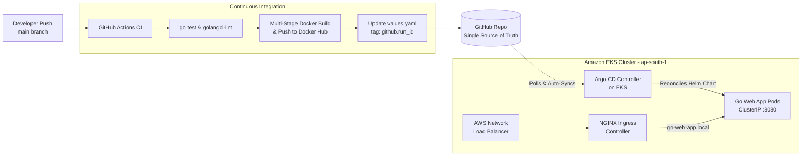

# Go Web Application — End-to-End CI/CD & GitOps on AWS EKS

A production-style DevOps implementation deploying a containerized Go web service onto **Amazon EKS** using **GitHub Actions**, **Docker**, **Helm**, **NGINX Ingress Controller**, and **Argo CD**.

Every push to `main` triggers an automated CI pipeline that runs unit tests, lints the codebase, builds and pushes an immutable Docker image tagged with the GitHub Actions run ID, and updates the Helm chart values in Git—allowing Argo CD to detect configuration drift and roll out updates with zero manual `kubectl` access.

---

## Application Preview


---

## Architecture & GitOps Flow



---

## Tech Stack

| Layer | Technologies |
| :--- | :--- |
| **Application** | Go (`net/http`), HTML/CSS static assets |
| **Containerization** | Docker (Multi-stage build: `golang` builder → lightweight runtime image) |
| **CI Pipeline** | GitHub Actions (`go test`, `golangci-lint`, Docker Hub push, automated `sed` tag update) |
| **Package Management** | Helm v3 (`helm/go-web-app-chart`) |
| **GitOps / CD** | Argo CD (Automated sync, self-heal, declarative drift remediation) |
| **Cloud & Networking** | Amazon EKS (`v1.34`), EC2 Managed Node Groups, AWS NLB, NGINX Ingress Controller |

---

## Repository Structure

```text
.
├── .github/workflows/ci.yaml      # CI workflow: test, lint, Docker push, and Helm tag bump
├── helm/go-web-app-chart/         # Parameterized Helm chart (Deployment, Service, Ingress, values.yaml)
├── k8s/manifests/                 # Raw Kubernetes manifests used for baseline validation
├── static/                        # Frontend HTML/CSS templates and preview assets
├── Dockerfile                     # Multi-stage production container definition
├── main.go                        # HTTP server entrypoint listening on port 8080 (/courses)
└── main_test.go                   # Unit tests
```

---

## Deployment & Reproduction Guide

### 1. Run Locally
```bash
go run main.go
# Open http://localhost:8080/courses
```

### 2. Provision Amazon EKS Cluster
```bash
eksctl create cluster \
  --name demo-cluster \
  --region ap-south-1 \
  --nodegroup-name workers \
  --node-type t3.small \
  --nodes 2 \
  --managed
```

### 3. Install NGINX Ingress Controller
```bash
kubectl apply -f https://githubusercontent.com
```
Once the Ingress resource receives an AWS NLB hostname (`kubectl get ing`), map its resolved IP to `go-web-app.local` in your local `hosts` file and access `http://go-web-app.local`.

### 4. Bootstrap Argo CD (GitOps CD)
```bash
kubectl create namespace argocd
kubectl apply -n argocd -f https://githubusercontent.com
kubectl patch svc argocd-server -n argocd -p '{"spec": {"type": "LoadBalancer"}}'
```
Create an Argo CD Application pointing to `helm/go-web-app-chart` on branch `main` with **Automated Sync** and **Self-Heal** enabled.

### 5. Configure GitHub Repository Secrets
Add the following under **Settings → Secrets and variables → Actions**:
* `DOCKERHUB_USERNAME` — Docker Hub account username
* `DOCKERHUB_TOKEN` — Docker Hub Personal Access Token (Read & Write)
* `TOKEN` — GitHub Classic PAT (`repo` scope) allowing CI to commit updated image tags back to `values.yaml`

### 6. Clean Teardown (Zero-Cost Cleanup)
```bash
kubectl delete namespace argocd ingress-nginx
eksctl delete cluster --name demo-cluster --region ap-south-1 --disable-nodegroup-eviction --wait
```

---

## Engineering Decisions & Lessons Learned

* **Zero-Credential CD Security:** GitHub Actions holds zero AWS IAM credentials or `kubeconfig` files. CI strictly updates declarative state in Git, while Argo CD reconciles cluster state from inside EKS.
* **Immutable Image Tagging:** Tagging images with `${{ github.run_id }}` rather than `:latest` guarantees deterministic rollbacks, clean Helm diff detection, and reliable rolling updates.
* **Worker Node Right-Sizing:** Running Argo CD, CoreDNS, VPC CNI, and NGINX Ingress alongside application pods requires `t3.small` instances (2 vCPU / 2 GB RAM, 11 pod IPs per node) to prevent `Pending` pod scheduling limits seen on `t3.micro`.
* **Cost-Safe Lifecycle:** Because EKS control planes, NAT Gateways, and Network Load Balancers bill hourly, clusters are provisioned declaratively via `eksctl` and torn down immediately post-validation.
